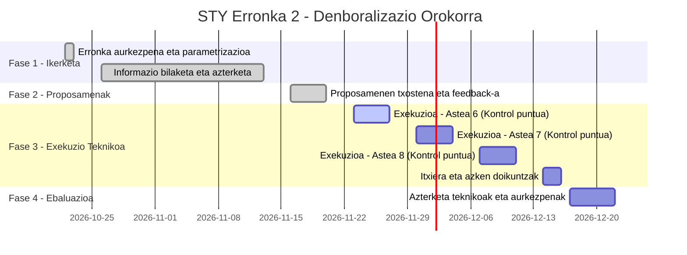

# STY Erronka 2 · Eguneroko Planifikazioa eta Jarraipena (Daily Log)

> **Proiektua:** STY (ServersToYou) – Enpresa baten IT sistemen ezarpena (Uni Center)  
> **Zentroa:** Uni Eibar-Ermua · SISA 2 (2026/2027)  
> **Metodologia:** Scrum / Agile + GitHub Projects Kanban  
> **Ebaluazio Erreferentzia:** WAE IE4 (Pisu Osoa: %10) – *Aurreratua (10): GitHub Projects erabili da plangintzarako, eguneroko jarraipena egin da, taldeko kide guztiek parte hartu dute repositoriotik, garapenean branch ezberdinak sartu dira eta ebidentziak ageri dira.*

---

## 👥 Taldearen Egitura eta Rolak

| Kidea | Erabiltzailea (GitHub) | Rola Taldean | Ardurak |
| :--- | :--- | :--- | :--- |
| **Hodei Basterretxea** | `@basterretxeahodei` | **Koordinatzailea** | Plangintzaren kontrola, GitHub Projects kudeaketa, barne-bilerak bideratu eta blokeoak konpondu. |
| **Jokin Carrasco** | `@Lobus12` | **Idazkaria / Teknikaria** | Dokumentazio teknikoaren bateratzea, txostenak osatu, Git adarren berrikuspena (PR). |
| **3. Taldekidea** | *[Erabiltzailea]* | **Komunikazio Arduraduna** | Taldearen bozeramailea, irakasleekiko komunikazioa, asteko laburpen-aktak idatzi. |
| **4. Taldekidea** | *[Erabiltzailea]* | **Laguntzailea / Denbora Kudeatzailea** | Baliabide materialen jarraipena, ISO/makinen zaintza, denbora-mugetara egokitzea. |

---

## 🧭 Planifikazioaren Egutegi Orokorra (9-10 Aste)

---

# 📅 Eguneroko Jarraipena (Daily Scrum)

---

## 📌 ASTEA 1: Erronkaren Hasiera eta Parametrizazioa (Urriak 22 – 23)

### 🗓️ Eguna 1 · Osteguna, 2026ko Urriak 22
* **Fasea:** 3. Erronka planteatzea & Taldea sortu / aktibatu.
* **Saioaren Helburua:** Erronka 2 aurkezpena jasotzea, taldea osatzea eta rolak banatzea.
* **Daily Standup:**
  * **Zer egin da gaur?**
    - Erronka 2 dokumentua (`Uni Center - Enpresa baten IT sistemen ezarpena`) aztertu.
    - Rolen banaketa adostu (Koordinatzailea, Komunikazioa, Idazkaria, Laguntzailea).
    - 1. Eranskina (Taldeko Konpromiso Kontratua) sinatu eta Moodle-ra igo.
  * **Blokeoak / Zailtasunak:** Hainbat modulu biltzen dituen proiektu konplexua da; lehentasunak sailkatu behar dira.
* **Atazen Egoera:**
  - [x] Taldearen konpromiso-kontratua idatzi (`Done`)
  - [x] Moodle ingurunea prestatu (`Done`)
  - [x] GitHub biltegi nagusia prestatu (`STY_erronka2` eta `STY_erronka2_Planifikazioa`) (`Done`)

### 🗓️ Eguna 2 · Ostirala, 2026ko Urriak 23
* **Fasea:** 3.3 Egoeratik erronkara & 3.4 Parametroak ezartzea.
* **Saioaren Helburua:** Uni Center enpresaren IT baldintzak eta murrizketak zerrendatzea (2. Eranskina).
* **Daily Standup:**
  * **Zer egin da gaur?**
    - Uni Center-en aurretiazko azpiegitura eta enpresa berriaren erosketak dakartzan aldaketak aztertu (2 domeinu, irisgarritasun beharrak, urruneko langileak VPN bidez).
    - Modulu bakoitzeko ikaskuntza-emaitzak (IE) mapeatu.
  * **Blokeoak / Zailtasunak:** Hardware eta software lizentzien inguruko zalantzak (libre vs jabeduna).
* **Atazen Egoera:**
  - [x] 2. Eranskina (Parametroak) zirriborroa idatzi (`Done`)
  - [x] Modulu teknikoen zerrenda eta arduren banaketa iniciala egin (`Done`)

---

## 📌 ASTEA 2: Informazioaren Bilaketa eta Arkitektura Diseinua (Urriak 26 – 30)

### 🗓️ Eguna 3 · Astelehena, 2026ko Urriak 26
* **Helburua:** Sare topologia orokorraren zirriborroa eta helbideratze-plana (DMZ, LAN nagusia, Domeinu berria).
* **Daily Standup:**
  * **Hodei:** pfSense suebakiaren interfazeak eta sare segmentazioa (VLAN / fisikoki banatutako azpisareak) ikertzen.
  * **Jokin:** Zerbitzari birtualen baliabideen estimazioa (RAM, CPU, Diskoa Proxmox ingurunerako).
  * **Kideak:** Software libreen aukeraketa (MariaDB, Apache, vsftpd, GLPI).
* **Git:** Adarra: `docs/network-architecture-draft`

### 🗓️ Eguna 4 · Asteartea, 2026ko Urriak 27
* **Helburua:** Active Directory domeinu nagusia eta konfiantza-erlazioaren parametroak ikertzea.
* **Daily Standup:**
  * **Hodei & Jokin:** Bi Windows Server domeinuren arteko konfiantza-motak (Bi norabidekoa, kanpokoa / basoa) konparatu.
  * **Kideak:** Erabiltzaile eta Segurtasun Taldeen hierarkia (OU diseinua) prestatzen.

### 🗓️ Eguna 5 · Asteazkena, 2026ko Urriak 28
* **Helburua:** Biltegiratze zentralizatua eta ez-erredundantea (TrueNAS / SMB) eta DFS mekanismoak.
* **Daily Standup:**
  * **Jokin:** TrueNAS Core / SCALE bidezko karpeta partekatuak eta baimenen kudeaketa.
  * **Hodei:** Active Directory GPO bidez unitate sareak (Z:) mapeatzeko script eta politikak.

### 🗓️ Eguna 6 · Osteguna, 2026ko Urriak 29
* **Helburua:** Datu-baseen arkitektura eta Intranetaren integrazio-baldintzak aztertzea.
* **Daily Standup:**
  * **Taldea:** MariaDB zerbitzariaren sarbide murrizketak (`bind-address`, LAN administratzailea vs Web zerbitzaria).
  * Intraneterako orrien fluxua adostu: `login.php` -> `index.php` -> `iruzkinak.php` -> GLPI lotura.

### 🗓️ Eguna 7 · Ostirala, 2026ko Urriak 30
* **Helburua:** 2. Astearen bateratze orokorra eta lehenengo txosten teknikoaren bilketa.
* **Daily Standup:**
  * Asteko aurrerapenak baloratu.
  * Sentsorizazio (ESP32/DHT22) eta Hacking Etikoaren laborategi-baldintzak zehaztu.

---

## 📌 ASTEA 3: Segurtasuna, Zerbitzu Aurreratuak eta Jasangarritasuna (Azaroak 02 – 06)

* *(Azaroak 02: Jai eguna / Asteburu luzea)*

### 🗓️ Eguna 8 · Asteartea, 2026ko Azaroak 03
* **Helburua:** Segurtasun perimetrala: pfSense Firewall arauak eta OpenVPN urruneko langileentzat.
* **Daily Standup:**
  * **Hodei:** pfSense NAT eta WAN/LAN/DMZ iragazte arauen zirriborroa.
  * **Jokin:** OpenVPN tunelaren ziurtagiri digitalak (CA, Server Cert, Client Certs).

### 🗓️ Eguna 9 · Asteazkena, 2026ko Azaroak 04
* **Helburua:** Segurtasun kopien eta software zerbitzariaren (FTPS / HTTPS) segurtasun plana.
* **Daily Standup:**
  * **Taldea:** vsftpd TLS konfigurazioa, chroot baimenak, eta `rsync` bidezko babeskopiak.
  * Web zerbitzarirako Let's Encrypt / Barne-CA SSL/TLS ziurtagiriak ikertu.

### 🗓️ Eguna 10 · Osteguna, 2026ko Azaroak 05
* **Helburua:** Irisgarritasuna eta lanpostuen egokitzapena (NVDA, Windows Lupa, Kontrastea).
* **Daily Standup:**
  * Ikusmen murriztuko 2 langileentzako hardware eta software eskakizunak zehaztu.
  * Proposamen ekonomikoa eta lizentzien konparazioa burutu.

### 🗓️ Eguna 11 · Ostirala, 2026ko Azaroak 06
* **Helburua:** Jasangarritasun plana (ESG, GJH/ODS 2030, zabor elektronikoa, telelana).
* **Daily Standup:**
  * 3 arloak (ingurumena, soziala, ekonomikoa) datu erreal eta simulatuen bidez egituratu.
  * Asteko balorazio bilera: Informazioaren bilaketa fasea %85ean dago.

---

## 📌 ASTEA 4: Alternatiben Balorazioa eta Konponbideak (Azaroak 09 – 13)

### 🗓️ Eguna 12 · Astelehena, 2026ko Azaroak 09
* **Helburua:** Alta Eskuragarritasuna (HA): Proxmox Klusterra eta Erredundantzia aukerak konparatu.
* **Daily Standup:**
  * Proxmox VE Corosync klusterra (2 nodo + QDevice edo quorum soluzioa).
  * ZFS RAID erredundantea biltegiratzean.

### 🗓️ Eguna 13 · Asteartea, 2026ko Azaroak 10
* **Helburua:** Hacking etikoa: Ahultasun azterketarako tresnak (Nmap, Metasploit, Nessus/OpenVAS).
* **Daily Standup:**
  * Proba-ingurune isolatuko makina ahulgarria aukeratu (Metasploitable2 edo Ubuntu zaurgarria).
  * Baimendutako IP barrutiak eta auditoretza-metodologia finkatu.

### 🗓️ Eguna 14 · Asteazkena, 2026ko Azaroak 11
* **Helburua:** IoT Sentsorizazioa: ESP32 mikrokontroladorea eta MySQL/MariaDB integrazioa.
* **Daily Standup:**
  * DHT22 sentsorearen irakurketak (tenperatura, hezetasuna) REST API / PHP script bidez datu-basera bidaltzeko arkitektura.

### 🗓️ Eguna 15 · Osteguna, 2026ko Azaroak 12
* **Helburua:** PowerShell bidezko administrazio automatizatua eta bekadunaren prestakuntza ikastaroa.
* **Daily Standup:**
  * OpenSSH Windows Server-en aktibatzeko gida.
  * OU, Talde eta Erabiltzaileak masiboki sortzeko PowerShell script-en diseinua.

### 🗓️ Eguna 16 · Ostirala, 2026ko Azaroak 13
* **Helburua:** Informazio bilaketaren itxiera eta proposamen-faseko dokumentazioa bateratzea.
* **Daily Standup:**
  * Informazio guztia biltegietan ordenatuta dagoela ziurtatu.
  * Asteleheneko proposamen aurkezpena prestatzen hasi.

---

## 📌 ASTEA 5: Proposamenak, Diseinu Formala eta Feedback-a (Azaroak 16 – 20)

### 🗓️ Eguna 17 · Astelehena, 2026ko Azaroak 16
* **Helburua:** 4. Eranskinaren zirriborroa: aukeratutako irtenbide teknikoak eta alternatiben alde onak/txarrak.
* **Daily Standup:**
  * Aurkezpen diapositibak prestatzen (`ServersToYou_Erronka2_Proposamenak.pdf`).
  * Taldekide bakoitzak bere atalaren defentsa prestatzen du.

### 🗓️ Eguna 18 · Asteartea, 2026ko Azaroak 17
* **Helburua:** Proposamenaren aurkezpena fintzea eta materialak berrikustea.
* **Daily Standup:**
  * Denbora neurtu eta irakasleen balizko galderei erantzuteko argudioak finkatu.

### 🗓️ Eguna 19 · Asteazkena, 2026ko Azaroak 18 ⭐ (HITO NAGUSIA: PROPOSAMENAK ETA FEEDBACK-A)
* **Helburua:** Proposamen formala aurkeztea (3. Eranskineko 2. puntua) eta irakasleen feedback-a jasotzea.
* **Daily Standup:**
  * **Aurkezpena:** Taldeak STY erronkaren proposamen osoa aurkeztu die irakasleei.
  * **Feedback-a:** Irakasleek proposamena baliozkotu dute; exekuziorako hainbat ohar jaso dira (bereziki pfSense DMZ isolamenduan eta MariaDB baimenen bereizketan).
* **Emaitza:** Exekuzio-fasera igarotzeko baimen osoa lortu da!

### 🗓️ Eguna 20 · Osteguna, 2026ko Azaroak 19
* **Fasea:** 7. Exekuzioa hasi.
* **Helburua:** Birtualizazio ingurunea (Proxmox / IsardVDI) prestatzea eta oinarrizko ISOak kargatzea.
* **Daily Standup:**
  * VM-ak sortu: pfSense Router/Firewall, Windows Server 2022 (AD nagusia), Debian 12 (Web/DB), TrueNAS.
  * Sare-egitura birtuala konfiguratzen (vSwitch / VMbr0, VMbr1, VMbr2).

### 🗓️ Eguna 21 · Ostirala, 2026ko Azaroak 20
* **Helburua:** pfSense suebakiaren instalazioa eta interfaze nagusien konfigurazioa.
* **Daily Standup:**
  * WAN (DHCP), LAN (`192.168.10.0/24`), DMZ (`192.168.20.0/24`) asignatu.
  * DHCP zerbitzua LAN barruan martxan jarri.

---

## 📌 ASTEA 6: Exekuzio Teknikoa I – Oinarrizko Azpiegitura (Azaroak 23 – 27) 👈 [UNEKO ASTEA]

### 🗓️ Eguna 22 · Astelehena, 2026ko Azaroak 23
* **Fasea:** 7. Exekuzio Teknikoa.
* **Helburua:** Windows Server Active Directory instalazioa eta oinarrizko basoa (`sty.lan`).
* **Daily Standup:**
  * **Eginda:** Windows Server-en AD DS eta DNS rolak instalatu dira.
  * **Egiteke:** OU hierarkia eta domeinuaren segurtasun taldeak sortu.
  * **Blokeoak:** DNS berbideratzaileen konfigurazioa interneterako atzipena bermatzeko.

### 🗓️ Eguna 23 · Asteartea, 2026ko Azaroak 24 ⭐ [GAUR]
* **Fasea:** 7. Exekuzio Teknikoa & GitHub Projects Planifikazioa.
* **Helburua:** 
  1. `STY_erronka2_Planifikazioa` biltegian eguneroko jarraipena eta Kanban taula integratzea.
  2. MariaDB datu-base zerbitzariaren hedapena eta Intranetaren oinarrizko egituren garapena.
* **Daily Standup:**
  * **Hodei Basterretxea:** GitHub Projects taula sortu (To Do, In Progress, Review, Done) eta atazen esleipena osatu.
  * **Jokin Carrasco:** MariaDB instalatu Debian zerbitzarian, `bind-address` LAN-era mugatu, eta erabiltzaileen rolak konfiguratu (`admin_lan`, `web_user`).
  * **Kideak:** Intranetaren `login.php` eta PHP saioen arkitektura hasi.
* **Git Commit-ak eta Adarrak:**
  * Adarra: `feature/daily-planning-setup`
  * Kompromisoa: Eguneroko planifikazioa eta sprint fitxategiak egunean jartzea.

### 🗓️ Eguna 24 · Asteazkena, 2026ko Azaroak 25 ⭐ (TALDE KONTROL PUNTUA 1)
* **Helburua:** 1. Talde Kontrol Puntua irakasleekin pasatzea + Active Directory eta Linux urruneko administrazioa.
* **Aurreikusitako Atazak:**
  - [ ] Irakasleari aste honetako bilakaera eta GitHub Projects taula erakutsi.
  - [ ] Bekadunarentzako PowerShell gidoiak eta OpenSSH konexio segurua probatu.
  - [ ] Erronkaren Koadernoan 1. kontrol puntuko oharrak idatzi.

### 🗓️ Eguna 25 · Osteguna, 2026ko Azaroak 26
* **Helburua:** TrueNAS biltegiratzea eta SMB karpeta partekatuak baimen isolatuekin.
* **Aurreikusitako Atazak:**
  - [ ] TrueNAS disko igerilekua (ZFS) eta datu-multzoak (Datasets) sortu.
  - [ ] GPO bidez Windows bezeroei automatikoki sareko unitateak mapeatu.

### 🗓️ Eguna 26 · Ostirala, 2026ko Azaroak 27
* **Helburua:** 6. Astearen berrikuspena (Sprint Review I) eta asteburuko lanen egoera finkatzea.
* **Aurreikusitako Atazak:**
  - [ ] AD nagusia eta bezeroen domeinurako atxikipena egiaztatuta uztea.
  - [ ] Intraneteko datu-basearen lehenengo taulak (`erabiltzaileak`, `iruzkinak`) migratu.

---

## 📌 ASTEA 7: Exekuzio Teknikoa II – Zerbitzu Aurreratuak eta Segurtasuna (Azaroak 30 – Abenduak 04)

* *(Azaroak 30: Jai eguna)*

### 🗓️ Eguna 27 · Asteartea, 2026ko Abenduak 01
* **Helburua:** Bi domeinuen arteko konfiantza-erlazioa eta bigarren domeinuaren baliabideak integratzea.
* **Aurreikusitako Atazak:**
  - [ ] 2. Windows Server domeinua altxatu eta konfiantza-erlazioa konfiguratu.
  - [ ] Bi domeinuetako erabiltzaileek biltegiratzeak eta inprimagailuak atzitzeko baimenak probatu.

### 🗓️ Eguna 28 · Asteazkena, 2026ko Abenduak 02 ⭐ (TALDE KONTROL PUNTUA 2)
* **Helburua:** 2. Talde Kontrol Puntua irakasleekin + pfSense VPN eta DMZ zerbitzuak.
* **Aurreikusitako Atazak:**
  - [ ] pfSense OpenVPN zerbitzaria martxan jarri eta kanpoko langilearen bezeroarekin proba egin.
  - [ ] Kontrol puntuko ebaluazioa eta feedback-a jaso.

### 🗓️ Eguna 29 · Osteguna, 2026ko Abenduak 03
* **Helburua:** Web korporatiboa, Ticketing aplikazioa (GLPI) eta FTPS segurua.
* **Aurreikusitako Atazak:**
  - [ ] Intraneteko iruzkinen panela eta GLPI lotura ezarri.
  - [ ] vsftpd zerbitzarian SSL/TLS ziurtagiria eta chroot isolamendua probatu.

### 🗓️ Eguna 30 · Ostirala, 2026ko Abenduak 04
* **Helburua:** Irisgarritasuna eta bezeroen lanpostuak egokitzea.
* **Aurreikusitako Atazak:**
  - [ ] Ikusmen murriztuko lanpostuetan NVDA, Windows Lupa eta Kontraste altuko profilak konfiguratu eta balidatu.

---

## 📌 ASTEA 8: Exekuzio Teknikoa III – HA Klusterra, IoT eta Pentesting (Abenduak 07 – 11)

* *(Abenduak 07 eta 08: Jai egunak)*

### 🗓️ Eguna 31 · Asteazkena, 2026ko Abenduak 09 ⭐ (TALDE KONTROL PUNTUA 3)
* **Helburua:** 3. Talde Kontrol Puntua + Proxmox HA Klusterra.
* **Aurreikusitako Atazak:**
  - [ ] Proxmox nodo bikoitzeko klusterra martxan jarri eta akats-simulazioa (failover) probatu.
  - [ ] Azken aurreko kontrol puntuko berrikuspena irakasleekin.

### 🗓️ Eguna 32 · Osteguna, 2026ko Abenduak 10
* **Helburua:** IoT Sentsorizazioaren integrazio osoa eta Ingurumen Datuak.
* **Aurreikusitako Atazak:**
  - [ ] ESP32 + DHT22 sentsoreak datuak automatikoki MariaDBra bidaltzen dituela ziurtatu.
  - [ ] Web intranetean tenperatura eta hezetasun grafikoak bistaratu.

### 🗓️ Eguna 33 · Ostirala, 2026ko Abenduak 11
* **Helburua:** Hacking etikoa eta LAN segurtasun auditoria.
* **Aurreikusitako Atazak:**
  - [ ] Kali Linux-etik sareko makina ahulgarriari (Metasploitable) eskaneoak eta eraso kontrolatuak egin.
  - [ ] Zaurgarritasun txostena eta konponbide/kontraneurriak dokumentatu.

---

## 📌 ASTEA 9: Itxiera Teknikoa, Babeskopiak eta Proposamen Ebaluazioa (Abenduak 14 – 18)

### 🗓️ Eguna 34 · Astelehena, 2026ko Abenduak 14
* **Helburua:** Babeskopia eta berreskuratze sistemen balidazioa (Clonezilla & mysqldump).
* **Aurreikusitako Atazak:**
  - [ ] Erabiltzaile eta zerbitzari nagusien irudiak sortu eta TrueNAS-en biltegiratu.
  - [ ] Ataza automatizatuak (cron eta Task Scheduler) egiaztatu.

### 🗓️ Eguna 35 · Asteartea, 2026ko Abenduak 15
* **Helburua:** Dokumentazio teknikoaren azken berrikuspena (`STY_erronka2/docs/*.md`).
* **Aurreikusitako Atazak:**
  - [ ] 10 moduluetako ebidentzia, irudi eta konfigurazioak berrikusi.
  - [ ] Jasangarritasun txostena (GJH 2030) datu errealekin itxi.

### 🗓️ Eguna 36 · Asteazkena, 2026ko Abenduak 16 ⭐ (PROPOSAMENAK PRESTATU ETA FEEDBACK AMAIERA)
* **Helburua:** Emaitzen aurkezpenaren entsegua eta azken hobekuntza-eremuen ebaluazioa.
* **Aurreikusitako Atazak:**
  - [ ] 5. Eranskinaren taula bete (Denborak, Baliabideak, Erronka bera, Irakasle-taldea, Ikasle-taldea).
  - [ ] Azken aurkezpenaren diapositibak amaitu.

### 🗓️ Eguna 37 · Osteguna, 2026ko Abenduak 17 ⭐ (AZTERKETAK)
* **Helburua:** Moduluen banakako proba teknikoak (Azterketak).

### 🗓️ Eguna 38 · Ostirala, 2026ko Abenduak 18 ⭐ (AZTERKETAK)
* **Helburua:** Moduluen banakako proba teknikoak (Azterketak).

---

## 📌 ASTEA 10: Azken Aurkezpenak eta Ebaluazioa (Abenduak 21 – 22)

### 🗓️ Eguna 39 · Astelehena, 2026ko Abenduak 21
* **Helburua:** Erronkaren azken aurkezpen ofiziala epaimahaiaren / irakasleen aurrean.
* **Aurreikusitako Atazak:**
  - [ ] Proiektuaren demo praktikoa (AD, pfSense, Intranet, HA klusterra, IoT panela).
  - [ ] Autoebaluazioa eta taldekideen arteko koebaluazioa bete.

### 🗓️ Eguna 40 · Asteartea, 2026ko Abenduak 22
* **Helburua:** Erronka 2ren itxiera, feedback orokorra eta kalifikazioen bilketa.
